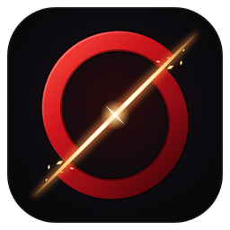

<div align="center">



# unaware

**An autonomous Pokémon Showdown player for Gen 9 singles, with a desktop launcher.**

</div>

---

### about

```text
what      plays ranked gen9 singles on Pokémon Showdown by itself
how       Foul Play's MCTS search on a patched Rust engine, plus my own layers on top
stack     Python, asyncio, React + TypeScript, Rust (poke-engine), PyTorch, SQLite
platform  Windows 10/11 (x64), Python 3.12
```

Unaware logs into your Showdown account, queues for the ladder (or challenges a
player) and plays every turn. The launcher
shows the battles in progress, your Elo, the history with a short analysis of each
game, and lets you build and switch teams.

### how it decides

- **Search.** Each turn the opponent's hidden sets are sampled 32 times from Smogon
  usage stats and what the battle has already revealed. [Foul Play](https://github.com/pmariglia/foul-play)
  runs a Monte Carlo tree search on every sampled world with
  [poke-engine](https://github.com/pmariglia/poke-engine) and the results are summed.
  Thinking time follows the ladder clock, with more time for endgames.
- **Scouting.** Before the battle it reads the opponent's public replays and your own
  past games against them. Games with the same team weigh the set sampling (moves,
  items, Tera) toward what that player actually runs.
- **Hybrid engine.** A small transformer (policy + value, ~1M parameters, trained by
  self-play on the same engine) only breaks Foul Play's near-ties instead of picking
  at random. The weights ship in `unaware/neural/weights.pt`.
- **Guards.** A few things the search kept getting wrong on the ladder are handled
  before the final pick: moves that cannot do anything (immunities, maxed hazards),
  loops with no progress, attacking into Destiny Bond, staying choice-locked into a
  resisted move, and missing a guaranteed KO.
- **Win chance.** A logistic model fitted on real games (Pokémon alive and HP on
  both sides), nudged by the value network and smoothed between turns.

### install

1. Install **Python 3.12 (64-bit)** from [python.org](https://www.python.org/downloads/) and tick *Add Python to PATH*.
2. Download this repository and run **`start.bat`**.

The first run needs internet. It creates `.venv`, installs the Python dependencies,
downloads Node.js into `runtime/` and installs the Showdown simulator from the npm
lockfile. The patched poke-engine wheel ships in `vendor/wheels/`.
Run `start.bat` again, or use the `Unaware` shortcut it creates, to open the launcher.

To check the installation without opening the app:

```powershell
powershell.exe -NoProfile -ExecutionPolicy Bypass -File .\start.ps1 -CheckOnly
```

### use

- **Settings → Account**: your Showdown username, and its password if the name is
  registered (unregistered names log in without one). The password is kept on this
  PC only, encrypted with Windows DPAPI.
- **Teams**: paste a Showdown export, import a `.txt`, or pick one from the library.
- **Start** queues for the selected format. **Autoplay** keeps queueing; **New battle**
  opens another ladder game next to the running one.
- **Watch** opens the room on play.pokemonshowdown.com in your browser.
- If the app closes mid-battle, **Settings → Recover battle** reconnects and continues
  from the current turn.

### layout

```text
unaware/        app: launcher backend, battle runner, Foul Play bridge, guards, scouting, learning
unaware/neural/ value/policy network, win chance model
frontend/       launcher UI (React + Vite), built into frontend/dist
vendor/         Foul Play (GPL-3.0), poke-engine patch and the built wheel
runtime/        Node.js and Showdown setup files; first run downloads the runtime here
teams/          starter teams
tools/          benchmarks (bench.py, team_trial.py), loss replays (fp_replay.py), network training
tests/          pytest suite
```

### development

Install Node.js with npm to run the frontend commands below.

```powershell
.\.venv\Scripts\python -m pip install -e ".[test]"
.\.venv\Scripts\python -m pytest
Push-Location frontend
npm ci
npm test
npm run build
Pop-Location
```

Benchmarks need a local server: `node pokemon-showdown start --skip-build --no-security 8000`
inside `runtime/node_modules/pokemon-showdown`.

```powershell
.\.venv\Scripts\python tools\bench.py headtohead --a "foulplay@8x2500/w32" --b "foulplay@8x2500/w8" --games 40
```

### credits

- [Foul Play](https://github.com/pmariglia/foul-play) and [poke-engine](https://github.com/pmariglia/poke-engine) by pmariglia: the search this bot is built on (GPL-3.0).
- [poke-env](https://github.com/hsahovic/poke-env) for the Showdown client and battle state.
- [Pokémon Showdown](https://github.com/smogon/pokemon-showdown) for the simulator, and [Smogon](https://www.smogon.com/stats/) for usage statistics.

Unaware is a fan project, not affiliated with Nintendo, Game Freak, The Pokémon
Company or Smogon. Pokémon names belong to their owners. Follow Pokémon Showdown's
rules when you run it on the public ladder.

### license

GPL-3.0, see [LICENSE](LICENSE).
